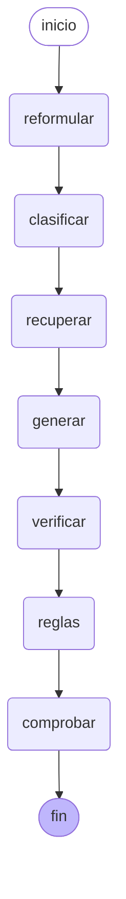

# Motor conversacional con LangGraph y LangChain

Desde el 9 de octubre de 2026 el motor conversacional es un **grafo de LangGraph** armado con
**piezas de LangChain**. Reemplaza la secuencia LCEL del 22 de septiembre
([avance de Exequiel](avance-exequiel.md)). Empezó con tres nodos; el 14 de octubre se sumaron
`reformular`, `verificar` y `reglas`, y el 16 de octubre `comprobar`. Hoy son siete, en línea.

El paso a LangGraph, el 9 de octubre, fue de arquitectura y no de conducta: el bot siguió
haciendo las mismas llamadas al modelo, con el mismo prompt, y las pruebas que ya fijaban el motor
(`test_rag_chain.py`, `test_public_chat.py`, `test_memory.py`, `test_motor_evaluation.py`)
pasaron sin cambiar una línea. Los nodos nuevos sí cambian la conducta, y cada uno trae sus
pruebas (`test_verificacion_reglas.py`, `test_comprobacion.py`, `test_motor_langgraph.py`).

Por pregunta, el motor hace hasta **cinco llamadas al proveedor**: reformular, clasificar (solo
si las reglas y los temas no deciden), generar, verificar y reglas (solo si la empresa escribió
reglas). Los pasos auxiliares se saltan solos si el proveedor falla o está al límite; `generar`
es el único imprescindible.

El código está en `backend/app/services/rag.py`, `llm.py` y `memory.py`.

## El grafo



Este diagrama sale del grafo compilado. Para regenerarlo, desde `backend`:
`python -c "from app.services import rag; print(rag.diagrama())"`. Hay una prueba que falla
si los nodos o las aristas cambian, para que el diagrama no quede desactualizado sin que nadie lo note.

| Nodo | Qué hace |
|---|---|
| `reformular` | Con los últimos 6 mensajes, la IA convierte el mensaje en una pregunta completa («¿y cuánto cuesta?» → «¿cuánto cuesta el plan Fibra 600?») y suma palabras de búsqueda y sinónimos en el idioma de los documentos. Si el proveedor falla o está al límite, se sigue con el mensaje tal cual (`MOTOR_REFORMULAR`) |
| `clasificar` | Elige el agente, técnico o comercial: primero las reglas de `intent.py`, después los temas que la empresa escribió para cada agente y, si nada decide, el modelo con tope de 3 s. Si la empresa tiene el comercial deshabilitado, va al técnico |
| `recuperar` | Busca los pasajes con `RetrieverEmpresa`, con la pregunta reformulada y con el mensaje original: solo los de la empresa y del tipo del agente, más la web si el agente lo permite. La búsqueda es exacta dentro de la empresa ([búsqueda](busqueda.md), PR #30) |
| `generar` | Arma el prompt con los pasajes y el historial, llama al proveedor y registra los tokens consumidos |
| `verificar` | Un segundo prompt (`verificar` en `app/data/prompts.json`) revisa la respuesta contra los pasajes y «Sobre la empresa» y da un veredicto: `aprobada`, `sin_sustento` (inventa datos: se cambia por el mensaje `sin_informacion` y cuenta como fallo del bot) o `fuera_de_alcance` (la pregunta no es de la empresa, como «¿cuánto es 4+4?»: se responde con `fuera_de_alcance` y no cuenta como fallo) |
| `reglas` | Si la empresa escribió **Reglas del negocio** en Configuración, un tercer prompt (`reglas_negocio`) ajusta la respuesta aprobada a ellas. Sin reglas, no llama al proveedor |
| `comprobar` | **Sin modelo** (`app/services/comprobacion.py`). Busca en la respuesta enlaces, correos, teléfonos, montos y porcentajes, y quita la línea que traiga uno que no aparezca en los pasajes (con la URL de cada página), en lo que escribió la empresa (instrucción del agente, «Sobre la empresa», reglas, sitio) ni en lo que dijo el cliente. Compara sin tildes ni separadores. Si no queda nada útil, responde `sin_informacion` y cuenta como fallo. PR #31 |

`verificar` y `reglas` nunca dejan al cliente sin respuesta: si el proveedor falla o tarda más
de `MOTOR_REVISION_TIMEOUT_S` (8 s), o hubo un límite de uso (429) en el último minuto, sale la
del paso anterior. `MOTOR_VERIFICAR=false` apaga la verificación. Las dos llamadas registran sus
tokens como consumo de la empresa. Por eso existe `comprobar`: como no depende del proveedor,
sigue protegiendo cuando la verificación no alcanzó a correr. En producción, con el proveedor
saturado, así se habían colado un teléfono y un correo inventados (Duoc UC, 15-10-2026). La vista
previa de Agentes del bot pasa por la misma revisión (`rag.revisar`), incluida la comprobación.

## Piezas de LangChain

| Pieza | Clase | Dónde se usa |
|---|---|---|
| **Chat model** | `ChatProveedor(BaseChatModel)`, en `llm.py` | En las tres cadenas. Envuelve el cliente del proveedor (Groq, DeepSeek o cualquiera con formato OpenAI) y conserva los errores propios (`LLMError`), la credencial de cada empresa y el conteo de tokens |
| **Prompts** | `ChatPromptTemplate` + `MessagesPlaceholder` | Respuesta del bot (`PROMPT_RESPUESTA`), sugerencias para el ejecutivo (`PROMPT_SUGERENCIA`) y resumen de la memoria (`PROMPT_RESUMEN`). El historial entra como mensajes, no pegado a mano |
| **Retriever** | `RetrieverEmpresa(BaseRetriever)`, en `rag.py` | Devuelve `Document` con la fuente, la similitud y el id del fragmento en los metadatos |
| **Composición** | `prompt \| modelo` (LCEL) | Las tres cadenas de arriba |
| **Paralelo** | `abatch` | Las sugerencias para el ejecutivo se piden todas a la vez; si una falla, se sugiere el pasaje tal cual |
| **Grafo** | `StateGraph` de LangGraph | El motor completo, con un estado tipado (`EstadoMotor`) |

## Aislamiento entre empresas

El grafo se **compila una sola vez** y lo comparten todas las peticiones. Lo que depende de
cada una (la sesión de base de datos, la empresa y la conversación) viaja en
`config["configurable"]`, nunca en el estado ni en la entrada: la empresa siempre la pone el
servidor.

`test_el_grafo_no_mezcla_empresas_en_peticiones_simultaneas` lanza dos preguntas a la vez, de
dos empresas distintas, y comprueba que cada una recibe solo sus fuentes.

## Latencia por nodo

`rag.answer` devuelve, además de la respuesta, `pasos`: la duración en milisegundos de cada
nodo. Por ejemplo: `[{"nodo": "clasificar", "ms": 3.1}, {"nodo": "recuperar", "ms": 41.7}, {"nodo": "generar", "ms": 812.4}]`.

Es la materia prima del informe de latencia: separa cuánto tarda la búsqueda de cuánto
tarda el modelo. Todavía no se guarda ni se expone por la API; ese es el paso siguiente del
informe.

## Ver cada respuesta en LangSmith

LangChain y LangGraph se trazan solos en [LangSmith](https://smith.langchain.com) si el
backend arranca con estas variables:

```
LANGSMITH_TRACING=true
LANGSMITH_API_KEY=<clave de LangSmith>
LANGSMITH_PROJECT=capstone-chatbot
```

Cada respuesta aparece como una ejecución de `motor_conversacional`, nodo por nodo: el prompt
exacto, los pasajes recuperados, los tokens y la duración. Sirve para depurar y para mostrar el
motor en la defensa.

**Cuidado:** las trazas incluyen los mensajes de los usuarios y los documentos de las
empresas. Conviene activarlo solo en desarrollo o en la demo con datos de prueba, no con
datos reales de clientes.

## Cómo crece

El grafo deja enchufar mejoras como nodos y aristas, sin tocar los nodos que ya existen. Así
entraron `reformular`, `verificar`, `reglas` y `comprobar`. La idea de un nodo `contextualizar`
para las preguntas de seguimiento quedó resuelta dentro de `reformular`, que corre en todos los
mensajes. Dos que siguen evaluadas y fuera de esta entrega:

- **Reintento si no encuentra.** Una arista condicional después de `recuperar`: si no hay
  pasajes, vuelve a buscar con otra redacción, una sola vez. Agrega una llamada al modelo, solo
  en ese caso.
- **«Quiero hablar con una persona».** Una arista condicional después de `clasificar`: si el
  mensaje pide un humano, va a un nodo `derivar` en vez de responder. Es clave en WhatsApp,
  que no tiene botón. No agrega llamadas.

Cada una es un `grafo.add_node(...)` y un `grafo.add_conditional_edges(...)` en
`rag._construir()`, más sus pruebas.

## Dependencias

`langgraph==1.2.*`, sobre el `langchain-core==1.6.4` que ya estaba. El SDK de LangGraph exige
`websockets<17`, así que la instalación baja `websockets` de 17.1 a 16.1. La versión 16 conserva
la API antigua que usa uvicorn 0.30 para el chat en vivo, y está comprobado que se importa bien.
