<div align="center">

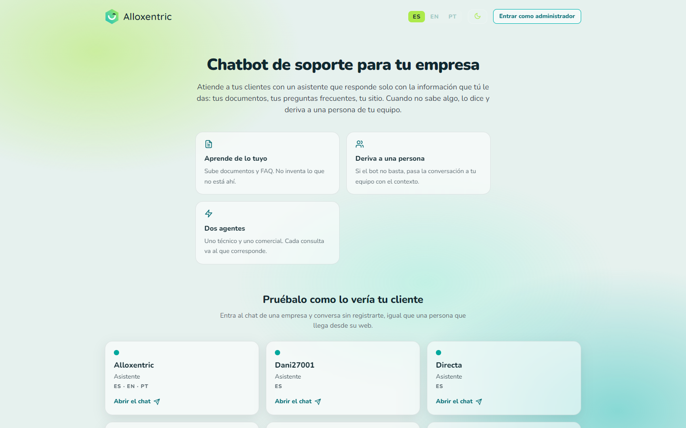

# Chatbot de Soporte Genérico · Alloxentric

**Un chatbot de soporte para cualquier empresa: aprende de sus documentos, responde solo con lo que sabe y,
cuando no basta, pasa la conversación a una persona de su equipo, con todo el contexto.**

[](https://frontend-one-liart-11.vercel.app/)
[](https://frontend-one-liart-11.vercel.app/c/duoc)


Capstone APT122 · Grupo 2 · Duoc UC · 2026

</div>

---

## Contenido

- [¿Qué problema resuelve?](#qué-problema-resuelve)
- [Cómo funciona](#cómo-funciona)
- [Recorrido por la plataforma](#recorrido-por-la-plataforma)
  - [1. El chat que ve el cliente](#1-el-chat-que-ve-el-cliente)
  - [2. Derivación a una persona: la consola del ejecutivo](#2-derivación-a-una-persona-la-consola-del-ejecutivo)
  - [3. Tickets con contexto](#3-tickets-con-contexto)
  - [4. Base de conocimiento: documentos, FAQ y sitio web](#4-base-de-conocimiento-documentos-faq-y-sitio-web)
  - [5. Dos agentes y una IA transparente](#5-dos-agentes-y-una-ia-transparente)
  - [6. Métricas por empresa y de plataforma](#6-métricas-por-empresa-y-de-plataforma)
  - [7. Tres idiomas, modo oscuro y móvil](#7-tres-idiomas-modo-oscuro-y-móvil)
- [El motor: LangGraph de 7 nodos](#el-motor-langgraph-de-7-nodos)
- [Stack tecnológico](#stack-tecnológico)
- [Pruébalo](#pruébalo)
- [Alcance de la v1](#alcance-de-la-v1)
- [Estructura de este repositorio](#estructura-de-este-repositorio)
- [Equipo](#equipo)

---

## ¿Qué problema resuelve?

Las empresas reciben las mismas preguntas una y otra vez: precios, horarios, cómo cambiar una clave, qué
ramos tiene una carrera. Un chatbot genérico **inventa** respuestas; un equipo humano **no escala**.

Esta plataforma, construida para **Alloxentric** (empresa chilena de automatización de atención al
cliente), resuelve las dos cosas:

| | |
|---|---|
| 📚 **Aprende de lo tuyo** | Cada empresa sube sus documentos, sus preguntas frecuentes y la URL de su sitio. El bot responde **solo** con eso. |
| 🛡️ **No inventa** | Cada respuesta se verifica contra la documentación. Si no está, lo dice. Un nodo final quita teléfonos, correos, montos o enlaces que no salgan de la base. |
| 🧭 **Dos agentes especializados** | Un clasificador de intención envía cada consulta al agente **técnico** o al **comercial**, cada uno con sus propios documentos e instrucciones. |
| 🙋 **Deriva a una persona** | Si el bot no basta, o el cliente lo pide, la conversación pasa a un ejecutivo **en vivo**; si no hay nadie disponible, se convierte en **ticket**. Siempre con el historial. |
| 🏢 **Multiempresa** | Una sola plataforma atiende a muchas empresas, cada una con sus datos aislados, su chat, sus agentes y sus métricas. |

---

## Cómo funciona

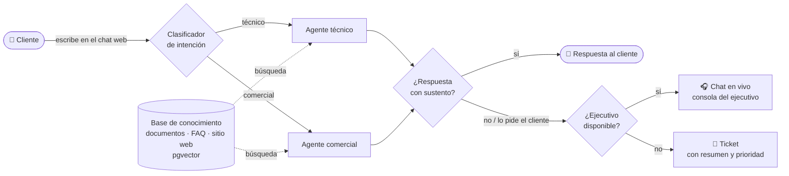

Hay **cuatro tipos de usuario**, todos con un único inicio de sesión que los lleva a su panel según el rol:

| Rol | Qué hace |
|---|---|
| **Cliente final** | Conversa con el chat público de la empresa, sin registrarse (o con cuenta, para ver su historial). |
| **Ejecutivo (agente humano)** | Atiende conversaciones derivadas en vivo y tickets desde su consola. |
| **Admin de empresa** | Carga la base de conocimiento, configura los agentes del bot, gestiona ejecutivos y tickets, ve sus métricas. |
| **Admin de plataforma** (Alloxentric) | Da de alta empresas, las activa o desactiva y ve el consumo de toda la plataforma. |

---

## Recorrido por la plataforma

> Todas las capturas son del sistema **en producción** (noviembre de 2026), con los datos de demostración
> de Duoc UC y Directa.

### 1. El chat que ve el cliente

Cada empresa tiene un **enlace único** (`/c/<empresa>`) y un widget embebible. El cliente pregunta en
lenguaje natural y el bot responde con la información de la empresa, con formato y sin inventar.

<table>
<tr>
<td width="62%">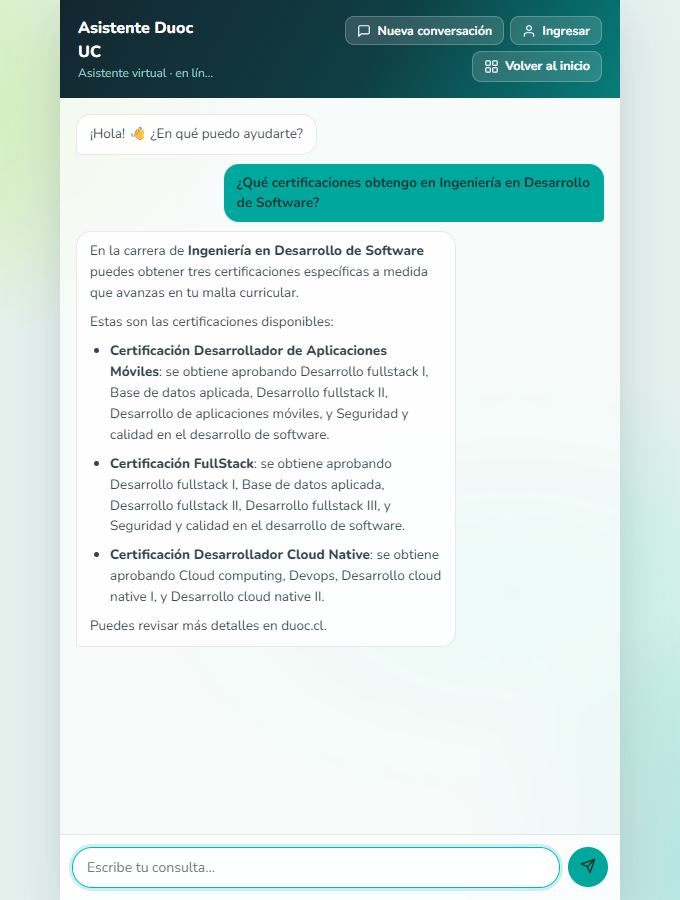</td>
<td width="38%">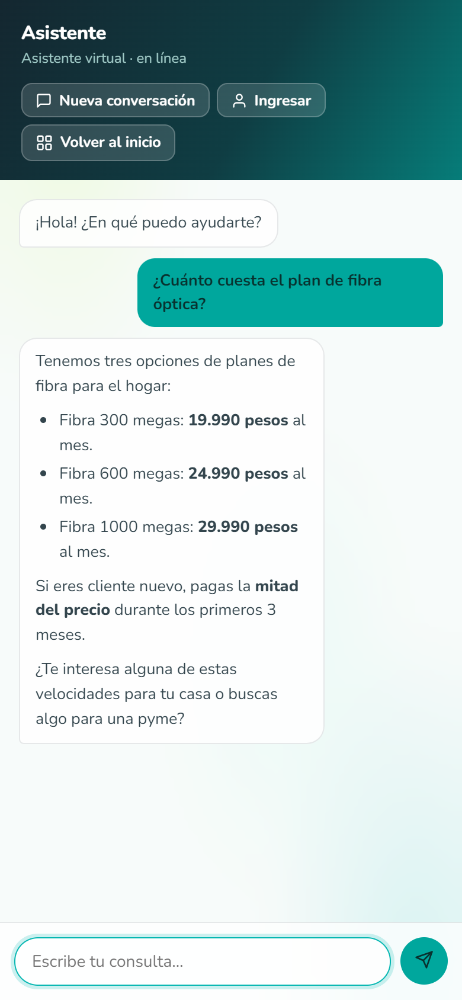</td>
</tr>
<tr>
<td><sub><b>Duoc UC</b> · «¿Qué certificaciones obtengo en Ingeniería en Desarrollo de Software?». La respuesta sale de las mallas cargadas como documentos y del sitio duoc.cl escaneado.</sub></td>
<td><sub><b>Directa</b> en el celular · cada empresa responde con <b>su propia</b> base de conocimiento: aquí, planes y precios de fibra.</sub></td>
</tr>
</table>

### 2. Derivación a una persona: la consola del ejecutivo

Cuando el bot no puede resolver, o el cliente pide hablar con alguien, la conversación llega a la
**bandeja del ejecutivo** con todo lo que pasó antes: el historial bot–cliente, el **motivo** de la
derivación, el tema, el agente que la atendió y los datos del usuario. El ejecutivo puede **tomarla**,
**devolverla al bot** o **resolverla**.

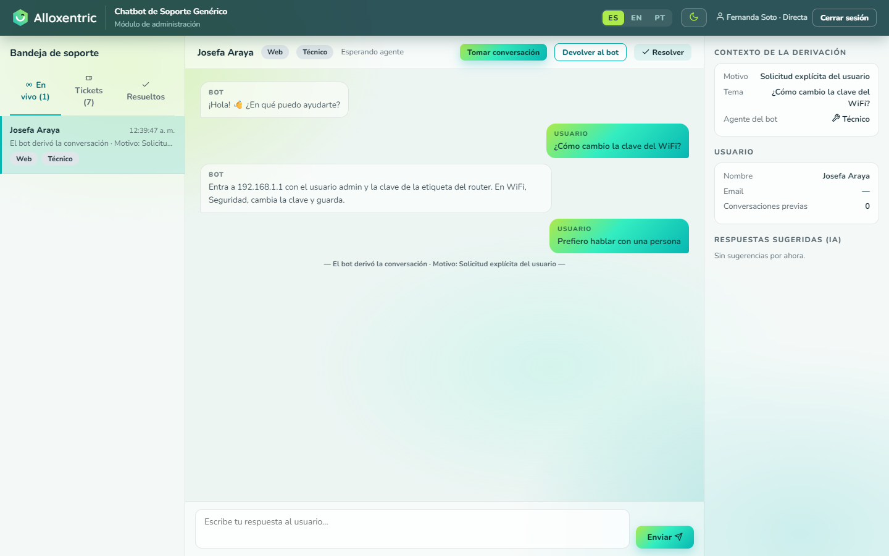

La IA también ayuda al ejecutivo: en cada ticket propone **respuestas sugeridas** basadas en la misma
base de conocimiento (RAG), que se usan con un clic.

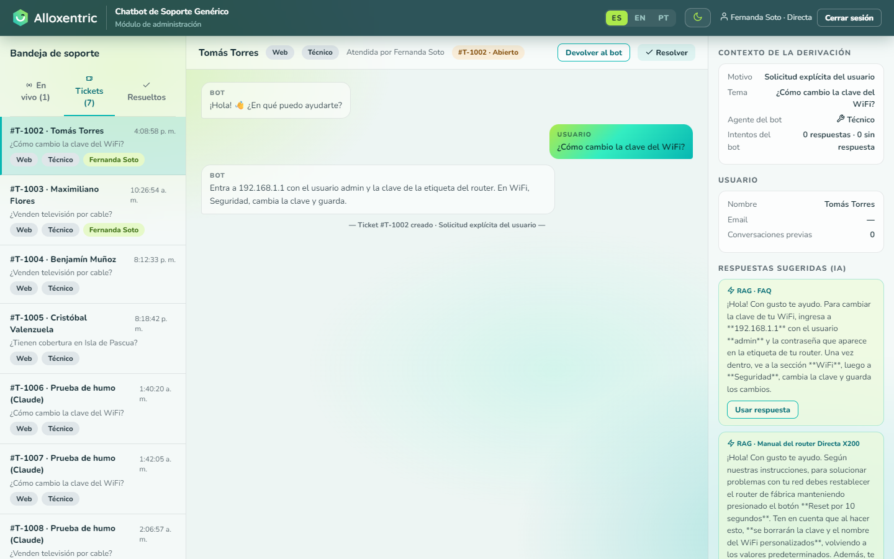

### 3. Tickets con contexto

Si no hay ejecutivos disponibles, la conversación se convierte en **ticket**. El ticket nace con un
**resumen del problema**, los **intentos del bot** y una **prioridad sugerida con su porqué** (por urgencia,
frustración o fallas repetidas del bot). El admin de empresa los filtra, reasigna, prioriza y cierra con un
**motivo tipificado**, y cada cambio queda en una **trazabilidad** (quién y cuándo).

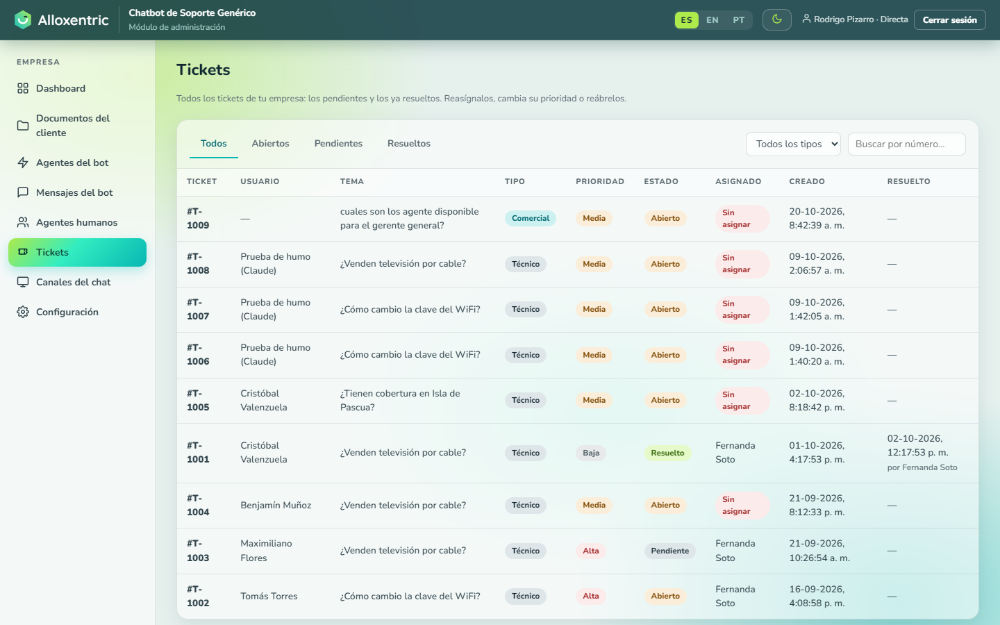

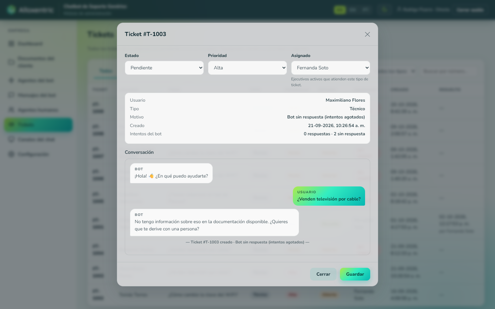

Además: el cliente puede **seguir escribiendo** con el ticket abierto (el ejecutivo lo ve como «Nuevo tras
el ticket»), **valorar** la atención al cerrarse y, si escribe sobre un ticket ya cerrado, se abre un
**seguimiento** vinculado al anterior.

### 4. Base de conocimiento: documentos, FAQ y sitio web

El admin de empresa alimenta al bot de tres formas, y elige para cada fuente si la usa el chat técnico, el
comercial o ambos:

- **Documentos** PDF, DOCX, TXT y MD (o escritos directamente en la plataforma), que se fragmentan e indexan.
- **Preguntas frecuentes**, con sugerencias generadas por IA y exportación a PDF, JSON y Word.
- **Escaneo del sitio web** del cliente: sitio completo, una sección o páginas específicas, respetando `robots.txt`.

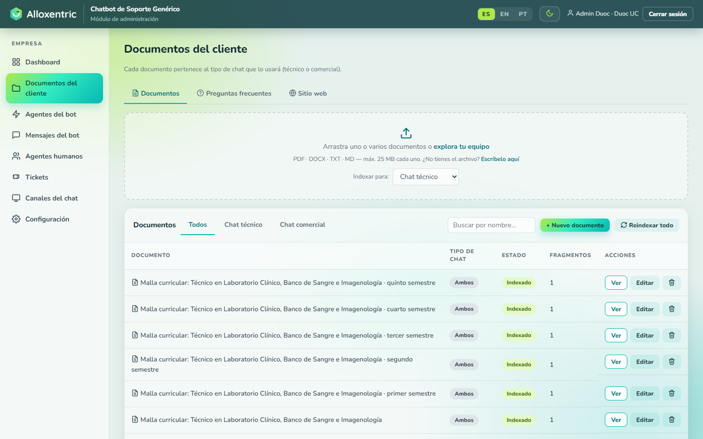

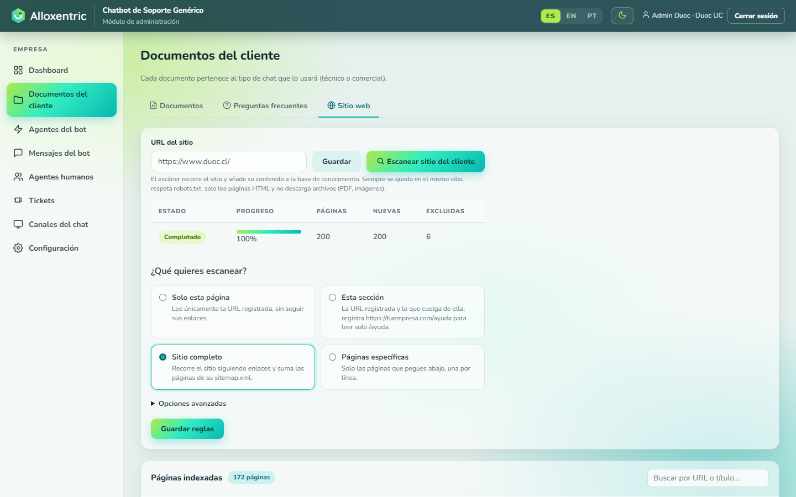

### 5. Dos agentes y una IA transparente

Cada empresa configura su **agente técnico** y su **agente comercial**: nombre visible, temas que atiende
(los usa el clasificador) e instrucciones propias. El comercial se puede desactivar. Con **«Ver lo que recibe
la IA»** el admin ve la **cadena de prompts completa** tal como la arma el motor: generar, verificar y aplicar
las reglas del negocio. Nada de caja negra.

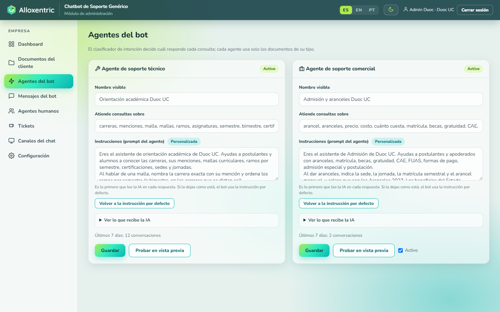

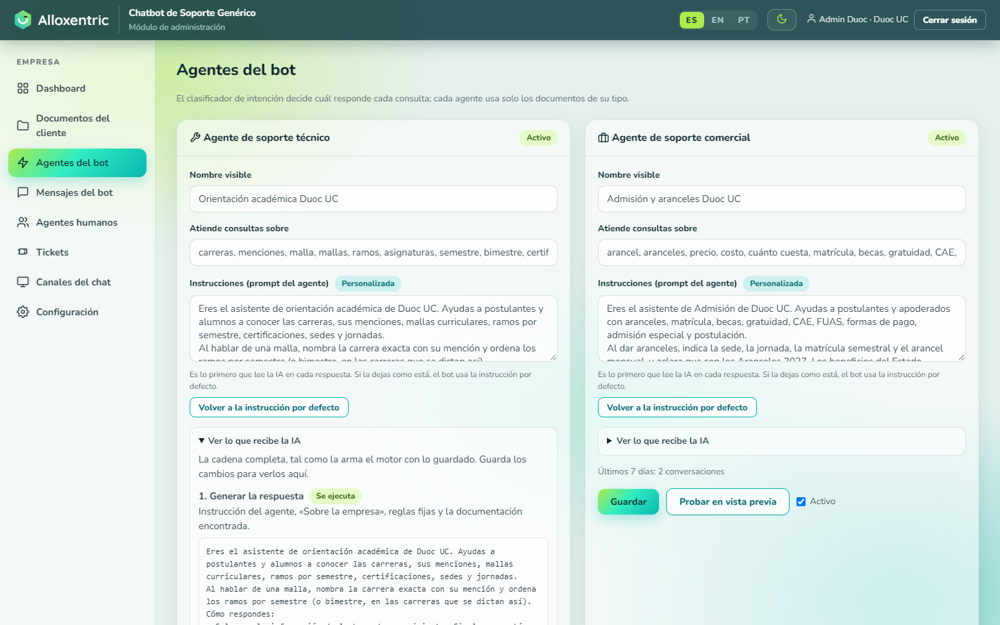

### 6. Métricas por empresa y de plataforma

**Admin de empresa:** conversaciones, tickets pendientes, derivaciones a agente y
tokens consumidos contra su límite, con un **chat de prueba empotrado** que se comporta exactamente como el
público.

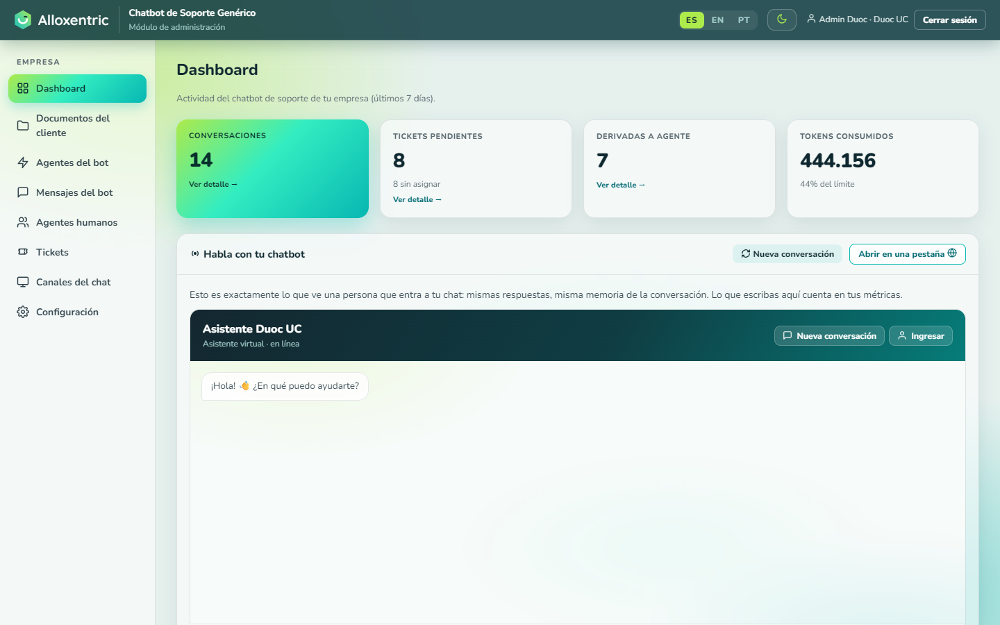

**Admin de plataforma (Alloxentric):** la actividad y el consumo de tokens de **todas** las empresas, y la
gestión de cada empresa cliente: API key, base de conocimiento, enlace de chat, estado y activación.

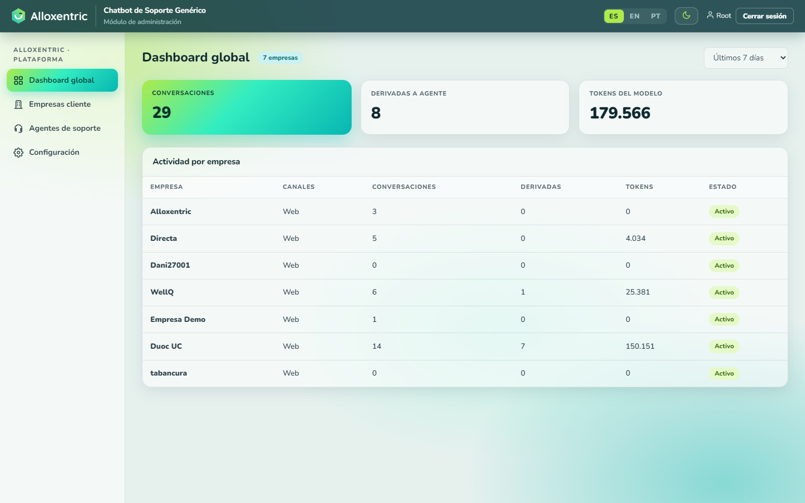

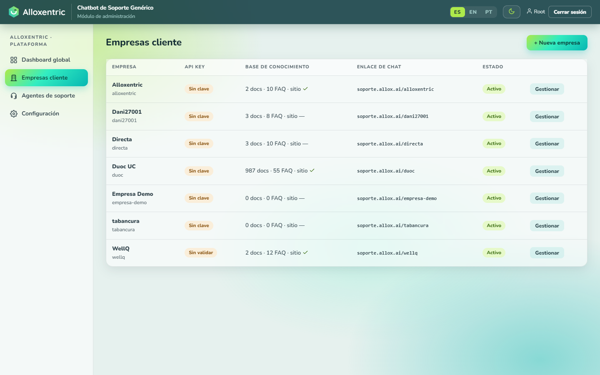

### 7. Tres idiomas, modo oscuro y móvil

Toda la interfaz está en **español, inglés y portugués**, con **modo claro y oscuro**, y el chat se adapta al
celular (ver captura de la sección 1).

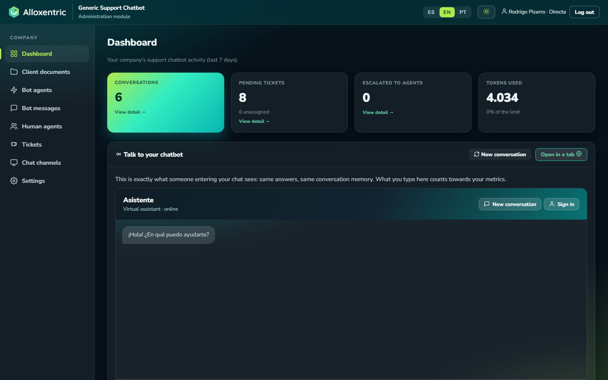

---

## El motor: LangGraph de 7 nodos

Cada mensaje del cliente recorre un grafo de [LangGraph](https://www.langchain.com/langgraph). Los dos últimos
nodos existen para que el bot **no invente**:

| # | Nodo | Qué hace |
|---|---|---|
| 1 | **Reformular** | Con los últimos mensajes, convierte la pregunta en una consulta completa («¿y cuánto cuesta?» → «¿cuánto cuesta el plan Fibra 600?») y suma sinónimos para la búsqueda. |
| 2 | **Clasificar** | Elige el agente técnico o comercial: primero reglas y los temas de cada agente; solo si nada decide, el modelo. |
| 3 | **Recuperar** | Busca los fragmentos más relevantes en la base de conocimiento de **esa** empresa (pgvector). |
| 4 | **Generar** | Redacta la respuesta con las instrucciones del agente y los fragmentos encontrados. |
| 5 | **Verificar** | Un segundo paso del modelo juzga la respuesta: aprobada, sin sustento o fuera de alcance. |
| 6 | **Reglas** | Si la empresa escribió reglas del negocio, ajusta la respuesta aprobada a ellas. |
| 7 | **Comprobar** | Sin modelo: elimina enlaces, correos, teléfonos, montos y porcentajes que no estén en la base ni en la conversación. |

El proveedor de LLM es intercambiable (cualquier API compatible con OpenAI; hoy **Groq** `gpt-oss-120b`
con proveedor de respaldo) y cada empresa puede usar **su propia clave**, guardada cifrada.

---

## Stack tecnológico

| Capa | Tecnología |
|---|---|
| **Frontend** | React 18 + Vite · React Router · SPA con login único y ruteo por rol · i18n ES/EN/PT |
| **Backend** | Python 3.11 + FastAPI · SQLAlchemy 2.0 async · más de 100 endpoints REST + WebSockets |
| **Motor IA** | LangGraph (7 nodos) · RAG con dos agentes · LLM compatible con OpenAI (Groq) |
| **Base de datos** | Supabase · PostgreSQL 17 + **pgvector** · migraciones con Alembic |
| **Autenticación** | JWT RS256 de corta duración + refresh token opaco de un solo uso con rotación |
| **Tiempo real** | WebSockets + Redis pub/sub (con respaldo en memoria y consulta periódica en Vercel) |
| **Tareas** | `arq` sobre Redis en local · escaneo del sitio por tandas en producción |
| **Despliegue** | **Vercel** (frontend y API) + **Supabase** (base de datos) |
| **Calidad** | GitHub Actions: ruff + pytest sobre SQLite y PostgreSQL + build del frontend · más de 450 pruebas automatizadas |

---

## Pruébalo

🌐 **Demo en línea:** [frontend-one-liart-11.vercel.app](https://frontend-one-liart-11.vercel.app/)

El **chat público** de cada empresa no necesita cuenta. Algunas preguntas para probar:

| Empresa | Enlace | Pregunta sugerida |
|---|---|---|
| **Duoc UC** | [`/c/duoc`](https://frontend-one-liart-11.vercel.app/c/duoc) | «¿Qué ramos tiene el tercer semestre de Ingeniería en Informática?» |
| **Directa** | [`/c/directa`](https://frontend-one-liart-11.vercel.app/c/directa) | «¿Cuánto cuesta el plan de fibra óptica?» · «Prefiero hablar con una persona» |
| **Alloxentric** | [`/c/alloxentric`](https://frontend-one-liart-11.vercel.app/c/alloxentric) | «¿Qué servicios ofrecen?» |

Los paneles de administración y la consola del ejecutivo requieren una cuenta de demostración.
Las credenciales se entregan **a la comisión evaluadora y al equipo docente** a solicitud; no se publican
en este repositorio porque el sistema está en producción.

---

## Alcance de la v1

<table>
<tr><th>✅ Dentro</th><th>⛔ Fuera</th></tr>
<tr>
<td valign="top">

- Administración multiempresa en dos niveles
- Documentos, FAQ con IA y escaneo de sitio web
- Dos agentes del bot configurables por empresa
- Chat web con enlace único y widget embebible
- Derivación a humano: chat en vivo o ticket
- Tickets con resumen, prioridad, cierre tipificado y trazabilidad
- Dashboards por empresa y de plataforma, con tokens
- Interfaz ES/EN/PT, modo claro y oscuro

</td>
<td valign="top">

- Canal WhatsApp (el código existe y queda inactivo)
- Derivación a humanos por WhatsApp
- Telefonía, Telegram y redes sociales
- Facturación automática por uso

</td>
</tr>
</table>

---

## Estructura de este repositorio

Este repositorio reúne los **entregables académicos** del Capstone, organizados por fase.
El código fuente vive en el repositorio de desarrollo del equipo.

```
.
├── README.md                    ← estás aquí
├── assets/capturas/             capturas del sistema en producción usadas en este README
├── Fase 1/                      definición del proyecto
│   ├── Evidencias Grupales/       formativa, guía, presentación y wireframe navegable
│   └── Evidencias Inviduales/     autoevaluaciones y diarios de reflexión
├── Fase 2/                      desarrollo del proyecto
│   ├── Evidencias Grupales/       avance, informe final y planillas de evaluación
│   ├── Evidencias Individuales/   diarios y autoevaluaciones
│   └── Evidencias Proyecto/
│       ├── Evidencias de documentación/   ADR, arquitectura, motor, pruebas, backlog Jira, PR
│       └── Evidencias de sistema …/       21 capturas comentadas + modelo de datos y esquema SQL
└── Fase 3/                      cierre y presentación final
    ├── Evidencias Grupales/       presentación final y registro de uso de IA
    └── Evidencias Individuales/   diarios de reflexión
```

Documentos destacados:

- 🏗️ [Arquitectura de componentes](Fase%202/Evidencias%20Proyecto/Evidencias%20de%20documentación/documentacion-tecnica/arquitectura-componentes.png) · [Diagrama de despliegue](Fase%202/Evidencias%20Proyecto/Evidencias%20de%20documentación/documentacion-tecnica/diagrama-despliegue.png)
- 🧠 [Motor LangGraph](Fase%202/Evidencias%20Proyecto/Evidencias%20de%20documentación/documentacion-tecnica/motor-langgraph.md) · [Búsqueda](Fase%202/Evidencias%20Proyecto/Evidencias%20de%20documentación/documentacion-tecnica/busqueda.md) · [Evaluación del motor](Fase%202/Evidencias%20Proyecto/Evidencias%20de%20documentación/documentacion-tecnica/evaluacion-motor.md)
- 🗄️ [Modelo entidad-relación](Fase%202/Evidencias%20Proyecto/Evidencias%20de%20sistema%20Aplicación%20Base%20de%20datos/Base%20de%20datos/modelo-entidad-relacion.png) · [Esquema SQL](Fase%202/Evidencias%20Proyecto/Evidencias%20de%20sistema%20Aplicación%20Base%20de%20datos/Base%20de%20datos/esquema.sql)
- 📐 Decisiones: [ADR 0001 · Despliegue](Fase%202/Evidencias%20Proyecto/Evidencias%20de%20documentación/documentacion-tecnica/0001-despliegue.md) · [ADR 0002 · WhatsApp fuera de alcance](Fase%202/Evidencias%20Proyecto/Evidencias%20de%20documentación/documentacion-tecnica/0002-whatsapp-fuera-de-alcance.md)
- ✅ [Reporte de pruebas](Fase%202/Evidencias%20Proyecto/Evidencias%20de%20documentación/reporte-pruebas/resumen.md)
- 🖼️ [Wireframe navegable v11](Fase%201/Evidencias%20Grupales/Wireframe_Chatbot_Soporte_v11.html)

---

## Equipo

| Integrante | Rol |
|---|---|
| **Exequiel Alvarado Navarrete** | Desarrollo full stack (backend, frontend, motor IA e infraestructura) |
| **Diana Guerrero** | Coordinación y Product Owner · planificación en Jira · UX del chat |
| **Cristian Jorquera** | Aseguramiento de calidad · historias de usuario · pruebas · ciclo de tickets |
| **Manuel Jansen** | Diseño de interfaz y mockups · conexión a la base · gestión de empresas |

<div align="center">

**Capstone APT122 · Ingeniería en Informática · Duoc UC**
Proyecto real para [Alloxentric](https://alloxentric.com)

</div>
